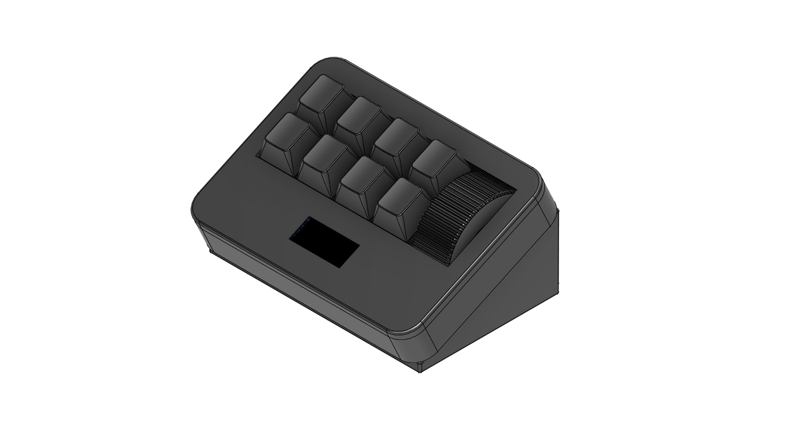
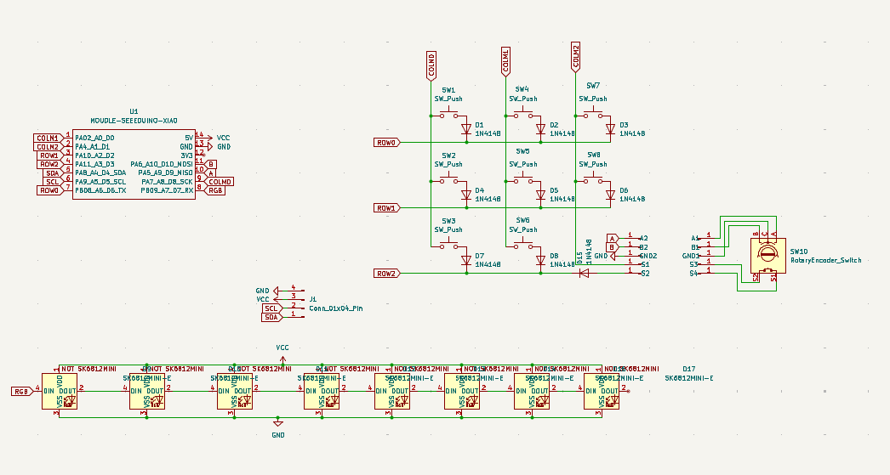
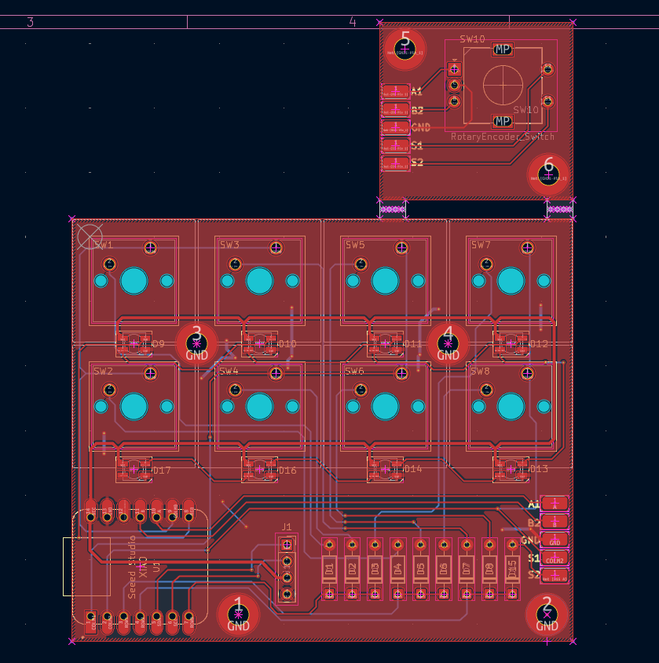

<h1>SleekPad</h1>

SleekPad is a simple and sleek stream deck type of micropad containing 9 buttons in total, 8 switches and 1 rotary switch, it also contains a horizontal knob compared to the usual vertical one, the design also contains programmable RGB and a programmable Display. 

<h2>Features:</h2>
<ul>
  <li>Sleek case design on a 25 degree angle</li> <li>128x32 OLED Display</li>
  <li>8 SK6812 MINI-E LEDs</li>
  <li>8 Switches</li>
  <li>1 EC11E Rotary encoder (with switch!)</li>
</ul>

<h2>CAD Model:</h2>

The design is made up of 3 layers, the top, middle and bottom, they all join together with the PCB with 4 M3 Bolts screwing into heatset inserts, the board is on a 25 degree angle to mimic the stream deck designs. 

<h5><i>Made in Fusion360.</i></h5>

<h2>PCB Model:</h2>

This is the pcb i designed, i have nothing much to say about it other than that its my first pcb and im proud of it.

Schematic:

 

PCB:
 
<h5><i>Made in KiCad.</i></h5>
<h2>Firmware:</h2>

I made the firmware with kmk, idk if it works because i need to get the materials to build this first and test it out , i plan to make the display, display time and have some functions that change its display depending on the buttons you press OR PROBABLY GO TO QMK so i can make a custom app to control it

<h2>BOM:</h2>
<table>
  <thead>
    <tr>
      <th>Amount</th>
      <th>Component / Description</th>
    </tr>
  </thead>
  <tbody>
    <tr>
      <td>8x</td>
      <td>MX-Style switches</td>
    </tr>
    <tr>
      <td>8x</td>
      <td>White blank DSA keycaps</td>
    </tr>
    <tr>
      <td>9x</td>
      <td>1N4148 Diodes</td>
    </tr>
    <tr>
      <td>8x</td>
      <td>SK6812 MINI-E LEDs</td>
    </tr>
    <tr>
      <td>1x</td>
      <td>EC11 Rotary Encoder</td>
    </tr>
    <tr>
      <td>1x</td>
      <td>Unsoldered Seeed XIAO RP2040</td>
    </tr>
    <tr>
      <td>1x</td>
      <td>0.91 inch OLED display</td>
    </tr>
    <tr>
      <td>1x</td>
      <td>PCB</td>
    </tr>
    <tr>
      <td>6x</td>
      <td>M3x16mm SHCS Bolts</td>
    </tr>
    <tr>
      <td>4x</td>
      <td>M3x5mmx4mm heatset inserts</td>
    </tr>
    <tr>
      <td>1x</td>
      <td>Case Top</td>
    </tr>
    <tr>
      <td>1x</td>
      <td>Case Middle</td>
    </tr>
    <tr>
      <td>1x</td>
      <td>Case Bottom</td>
    </tr>
    <tr>
      <td>1x</td>
      <td>Knob</td>
    </tr>
  </tbody>
</table>
